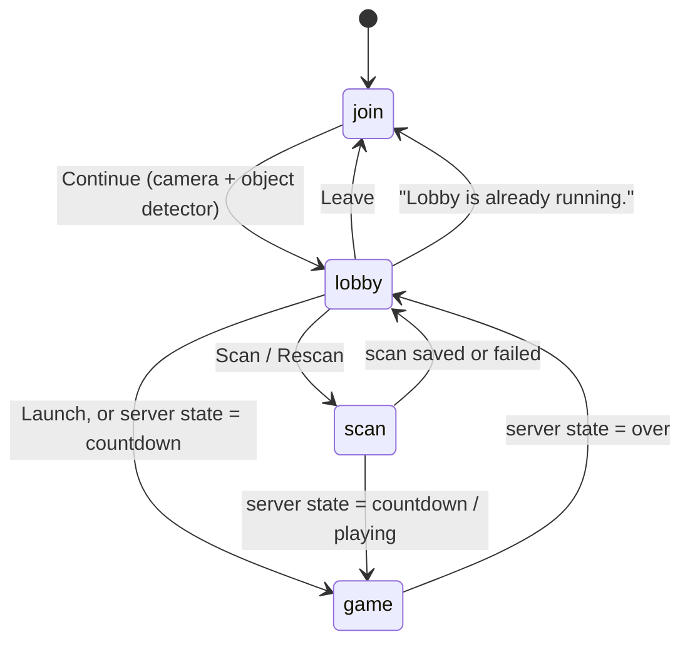

# App flow and screens

`frontend/public/app.js` is now just the entry point: it wires DOM events to the four screens and resumes an active lobby on load. Everything it used to own directly has moved into focused modules:

| Module | Used for |
| --- | --- |
| `env.js` | URL-parameter flags (`DEBUG` and the tuning overrides), `$()`, and the shared `video`/`canvas`/`ctx` |
| `state.js` | The one shared `state` object and the `localStorage` helpers |
| `roster.js` | Read-only lookups over the server's roster/game snapshot, plus `mergeRoster()` which folds in each roster delta |
| `camera.js` | Starting the camera and the on-device models, once, plus the first-inference warm-up |
| `startup.js` | What the player waits for on the way into the lobby, and what keeps loading behind them. No DOM and no imports, so the sequencing is testable on its own |
| `scan-reid.js` | The deferred OSNet pass at the end of a scan: which frames get embedded, and the averaging |
| `identity.js` | The one seam for "who is that person?": it installs a single identity provider at load and nothing else in the app knows which signals answer the question (see [Shooting](#who-counts-as-a-target) below) |
| `appearance-identity.js` | The provider installed by default: `isStableTarget()` and an appearance-only `resolve()` |
| `net.js` | Reconnect/resume and what each server message does to the screens, built on `transport.js`'s long-polling connection |
| `screens/join.js` | The join form and camera/model startup |
| `screens/lobby.js` | Lobby list, launch, leave |
| `screens/scan.js` | The rotation scan: recording, scoring, outlier/duplicate removal, the cache |
| `screens/game.js` | The frame loop, overlay, HUD/countdown and shooting |
| [`detector.js`](detection.md) | Creating the MediaPipe models and finding people in frames |
| [`identify.js`](identification.md) | Signatures, matching and the `Tracker` |
| [`reid.js`](identification.md#the-re-identification-embedding-reidjs) | The OSNet person re-identification embedding, the strongest identification signal when it loads |
| [`sound.js`](feedback.md) | Sound effects |

`frontend/public/index.html` contains all four screens as sibling `<main>` elements; only one is visible at a time. A single `<video>` element and an overlay `<canvas>` are shared by the scan and game screens, so the camera is only requested once.

## Screens

`state.mode` tracks the current screen: `'join' | 'lobby' | 'scan' | 'game'`.

### Join (`#join-screen`)

- Pre-fills name and room from `localStorage`, or the room from a `?room=` URL parameter. The default room is `demo`.
- On **Continue**: unlocks audio, then opens the connection to the room and starts the camera and the models.
- Failures show a friendly message (`startupErrorMessage`): not HTTPS, permission denied, no camera, or the raw error. A camera failure also leaves the room again, rather than parking a player in everyone else's roster who can never be scanned or shot.
- On success: switches to the lobby, requests a screen wake lock and starts the render loop.

#### What Continue actually waits for

This is the part worth getting right, because it used to be the longest wait in the app. There are 18 MB of models and **only the object detector is required** — see the Required column in [Detection → The models](detection.md). The lobby itself needs none of them: `renderLobby()` reads the roster and draws a Scan button per player.

So `prepareCameraAndDetector()` resolves on **camera + object detector**, 7.25 MB, and not on the other 10.9 MB. [`startup.js`](../../frontend/public/startup.js) owns the sequencing:

| Started | Waits for | Lobby waits for it? |
| --- | --- | --- |
| Camera (`getUserMedia`) | — | **Yes** |
| WebAssembly fileset | — | **Yes** |
| Object detector, 7.25 MB | the fileset | **Yes** |
| Pose landmarker, 5.78 MB | the fileset *and* the object detector's delegate | No |
| MobileNet embedder, 4.12 MB | the same | No |
| [OSNet re-identification](identification.md#the-re-identification-embedding-reidjs), 891 KB | nothing — separate runtime | No |

Three things follow from that table:

- **Pose and the embedder are created in parallel with each other, not serially.** Both hang off one continuation on the object detector's answer. They have to wait for it because whether MediaPipe can use the GPU is only discovered by trying, and the object detector's attempt is what decides it for all three — a mixed GPU/CPU set is not a thing we want. Their *downloads* are deliberately not overlapped with it either: prefetching them into the HTTP cache cannot work, because `frontend/common-locations.conf` serves `.tflite` and `.task` with `Cache-Control: no-store`, so the browser may not reuse the response and the "prefetch" would just download 9.9 MB twice.
- **`connect()` happens before the wait, not after it.** Joining a room is network I/O with nothing to do with the models, and the roster it answers with is the only thing the lobby list is made of, so the lobby arrives populated instead of empty. `net.js` reads name, room, `resumePlayerId` and `localGallery` out of `state`, all set before the call.
- **The optional models land in `state` whenever they arrive**, and the delegate label is rebuilt each time, so the overlay's `+Pose`/`+Embed`/`+ReID` suffixes still report exactly what this phone got. A model that failed stays `null` — the game degrades to the next signal down rather than breaking.

Nothing is fire-and-forget, though, because code downstream reads these models. The one screen that genuinely needs them waits for the specific ones it uses: [enrolment](scanning.md#1-countdown) blocks before its countdown until the embedder and the recogniser have landed, because a scan without them silently enrols *weaker* signatures into a gallery that is then cached and matched against for the whole round. A 20 s cap (`SCAN_MODEL_WAIT_MS`) keeps a hung download from trapping the player there.

With `?debug`, the overlay gets a `Startup` line with each step's duration and the two totals — time to lobby-visible and time to all-models-ready. See [Debug mode](../development/debug-mode.md#startup-and-scan-costs).

- **Warm-up.** Loading a model and being able to *run* one are different things: MediaPipe compiles its WebGL shaders and ONNX Runtime builds its WASM kernels on a model's first inference, which costs far more than the ones after it. That cost used to land wherever the first real frame happened to fall — during the scan for a phone that scanned somebody, but during the *countdown* for a phone that was only ever scanned by others. So every freshly loaded model gets one throwaway inference (`warmUpModels`), on a 512px-wide canvas matching the gameplay inference path. It is deliberately **not** awaited: it runs two frames later, so the join screen never waits for it. A warm-up that fails is only logged — the models still work cold, which is where this started.

  Since the models no longer finish together, the warm-up is now **per model, as each one arrives**, rather than one batch at the end. That needed one subtlety spelling out. `warmUpStep` normally stands down once a screen that infers is up, because the warm-up's deliberately-low timestamp would be a step backwards for a model the scan or game loop has already fed a `performance.now()` value. A model created a moment ago is exempt (`fresh`): MediaPipe's monotonic-timestamp rule is **per task instance**, so a brand-new task has never been handed a timestamp by anyone — and "the first inference has been paid anyway" is simply untrue of a model that did not exist when those loops started. Without the exemption, a late embedder would pay its first inference in the middle of processing a rotation, which is the exact cost the warm-up exists to move.

### Lobby (`#lobby-screen`)

- Rendered by `renderLobby()` from the latest `state` and `roster` messages.
- One row per player with a **Scan/Rescan** button. Debug clones have no button and show *"Mirrors <name>'s scan"*.
- **Launch** (`launchGame`) first checks locally that everyone is scanned, then starts a local countdown of `GAME_LAUNCH_COUNTDOWN_MS` (3 s, mirroring the server's `COUNTDOWN_MS`), switches to the game screen, and sends `{type: 'start'}`. The local countdown is only a prediction so the first second isn't dead time: every `state` message with status `countdown` resets it to the server's own `startsInMs`. If the server rejects the start, the client returns to the lobby with the error.
- **Launch** is disabled whenever the connection is down as well as while a round is running, because `start` has to reach the server; see [Networking → Leaving](networking.md#leaving-as-opposed-to-dropping).
- **Leave** (`leaveLobby`) goes through `leaveRoom({notify: true})`, which cancels any pending reconnect before telling the server (`sendBeacon` to `/api/disconnect`) — otherwise a drop in the last 1.5 s would rejoin the room behind the player. It then stops the camera, the identity provider and clears the saved lobby.

### Scan (`#scan-screen`)

`beginPlayerScan(player)` switches to this screen and starts `runAutoScan()` after the next paint. The full pipeline is described in [Scanning](scanning.md). While the scan screen is idle, the render loop draws every detected person, highlighting in green the one the scan would use.

A **✕** button in the corner calls `cancelScan()`, which just sets `state.autoScanning = false` and returns to the lobby with *"Scan cancelled."*. The recording, processing and countdown loops all check that flag every iteration and bail out cleanly, and their `finally` blocks notice the screen has changed and leave the UI alone.

A round that starts **during** a scan cancels it and takes the phone into the game, because `onState` can enter the game from `'scan'` as well as from `'lobby'`. Without that, both the `countdown` snapshot and the `playing` one behind it were recorded and dropped, and the phone landed back in a lobby with Launch and every Scan button disabled and nothing on screen to say a round was running — the server pushes a snapshot once per transition and then only on events, so it self-healed only when somebody landed a hit. Cancelling rather than merely switching screens is what retires the scan's run token, so a scan still parked on an `await` cannot finish later and pull the player out of the round.

### Game (`#game-screen`)

- `enterGame()` shows the camera, opens the SSE stream for the room and renders the HUD.
- Every frame, `loop()` runs detection when due, then `drawGame()` draws each live track with its hitboxes and label (see [Feedback](feedback.md#track-outlines)).
- **FIRE** (pointer down) or **Space** calls `fire()`. See [Shooting](#shooting).
- When a `state` message says `over`, every phone returns to the lobby showing *"You win!"* or *"<name> wins!"*.

## The render loop

`loop()` runs on every `requestAnimationFrame`:

1. If there's a new video frame and no scan is being post-processed:
   - **scan mode:** call `refreshScanPreview()`, which runs the cheap object-only pass on a 512-wide copy at most every 150 ms (`SCAN_PREVIEW_DETECT_INTERVAL_MS`) — and nothing at all while the rotation is being recorded (`state.recordingScan`). This is only the green highlight on the scan screen; the gallery is built afterwards from the recorded canvases. It used to run `detectScanPeople` — object detector *plus* pose landmarker — on the full-resolution video every single frame, which cost more than the entire processing pass that followed it;
   - **game mode:** call `refreshGameDetection()` if the detection interval has elapsed: 120 ms while acquiring people, 180 ms once every live track is identified, and never more often than the last detection's own time ÷ 0.7 (`DETECT_MAX_BUSY_SHARE`), so a phone that can't keep up stretches its own interval instead of spending more than ~70% of its time detecting — and not on a frame where the browser already has input waiting, see [Not detecting while input is pending](#not-detecting-while-input-is-pending).
2. `draw()` maps video coordinates to screen coordinates (the same maths as CSS `object-fit: cover`) and draws the overlay.
3. In game mode, update the countdown display.
4. In debug mode, update the debug overlay.

`refreshGameDetection()` downscales the frame to at most 512 px wide, detects people, scales the boxes back up, and passes them to `Tracker.update()` in closed-set mode along with the embedder and the re-identification handle (see [Identification](identification.md#5-closed-set-assignment)). It then hands the frame's tracks to `identity.observe()`. The loop never names the signal that identifies anyone, so a provider can be swapped without touching it.

### The main thread is the budget

Almost the whole vision pipeline is main-thread and synchronous — `detectForVideo()` in
[`detector.js`](detection.md), `embedForVideo()` and the colour signature's `getImageData()`
readback in [`identify.js`](identification.md) — and browsers do not preempt running JavaScript. So
every millisecond spent detecting is a millisecond in which a `pointerdown` on FIRE cannot be
delivered, and `DETECT_MAX_BUSY_SHARE` is the one knob that bounds it: detection may occupy at most
70% of the main thread, whatever cadence is being asked for.

That bound is why the target cadence is a *target*. `gameDetectInterval()` returns
`max(target, inferenceMs / 0.7)`, so a phone that needs 60 ms per detection settles at an 86 ms
interval on its own rather than running flat out and stuttering. Raising the requested rate cannot
make the button worse than that cap allows; it can only use headroom a fast phone already has.

An earlier version of this file also skipped a due detection whenever
`navigator.scheduling.isInputPending()` reported input waiting. It was deleted, and the reason is
worth keeping: on a phone the player's thumb rests on or near the FIRE button, so Chromium reports
pending input (touchmove included) more or less continuously during play. The deferral therefore
fired almost every frame and, bounded at 140 ms from when the detection came due, stretched a
120 ms interval to as much as 260 ms — less than half the intended tracking rate. It was a fix that
worked in theory and failed on contact with a real hand. The latency problem it was built for was
already solved properly, by taking the forced detection out of the shot path
([below](#why-the-shot-doesnt-force-a-detection)).

### Moving inference off the main thread

The cap above bounds the blocking chunk; it does not remove it. The real fix is **moving model
inference off the main thread into a Web Worker**, which is scoped but deliberately not done,
because it is a large and risky change rather than a tuning one.

What would move: the MediaPipe object detector, the pose landmarker and the MobileNet embedder (`detector.js`), `identify.js`'s `embedForVideo` call, and the colour-signature `getImageData()` readback. What makes it big:

- MediaPipe's tasks-vision bundle would have to be loaded inside the worker and fed `VideoFrame`s or an `OffscreenCanvas` transfer instead of the `<video>` element it reads today.
- `identify.js`'s tracker and gallery matching read `state` synchronously, so they would have to become asynchronous or be split in two.
- Every call site that treats detection as "returns boxes now" becomes a message round-trip, which changes the structure of the frame loop rather than one line in it.
- `?debug`'s timing lines would need the worker to report its own.

[`reid.js`](identification.md#the-re-identification-embedding-reidjs) is already off-thread (`ort.env.wasm.proxy = true`), so there is a precedent — but not a reusable one: it is ONNX Runtime's own proxying, not something MediaPipe offers. Expect a substantial change across `detector.js`, `identify.js`, `screens/game.js` and `screens/scan.js`, plus a new worker module and a new message protocol.

## Shooting

`fire()`:

1. Returns early unless the round is `playing`, the local player is alive, and 350 ms have passed since the last shot.
2. Plays the shot sound and button animation.
3. Hit-tests the **centre of the video frame**, which is also the centre of the screen because the video is centred with `object-fit: cover`.
4. If a targetable player is under the crosshair, POSTs `/api/hit` with the target and zone.

No detection runs anywhere in there. `fire()` takes one optional argument, the originating event's `timeStamp`, which `app.js` hands on from the `pointerdown`; it is read only by the `?debug` [input readout](../development/debug-mode.md#the-input-readout) and ignored otherwise.

### Why the shot doesn't force a detection

Step 3 used to be step 4. Before hit-testing, `fire()` checked whether the last detection was older than `SHOT_REFRESH_MAX_AGE_MS` (90 ms) and, if so, ran a full synchronous `refreshGameDetection({ forcePose: rosterCandidateCount() > 1 })` — the object detector, plus the pose landmarker once two or more players were enrolled — on the one path in the app where the player is actually waiting. That constant and the whole forced pass are gone.

Removing it was safe, and the reason is worth stating properly, because it is a correctness argument before it is a performance one.

**The shot already resolves against fresh data.** `targetUnderCrosshair()` hit-tests `liveBox()`, which projects each track's box along its smoothed velocity up to 0.25 s ahead. 90 ms sits comfortably inside that window, so the projected box already *is* where the person is now — computed from work that has already been paid for. A detection at 90 ms of age is not a stale box; it is a box plus 90 ms of extrapolation.

**And the refresh was breaking the guarantee it looked like it was protecting.** `drawGame()` calls the *same* `targetUnderCrosshair()` on every frame, to decide whether the crosshair gets its `on-target` class. So the player taps *because the crosshair went red* — and a detection that runs **after** the tap can move that box or lose it entirely, resolving the shot against data the player never saw. "What you see is what you hit" is the guarantee, and a forced refresh inside `fire()` violates it: the frame the player aimed on is discarded and replaced, between the decision to shoot and the shot.

Nor did it retire departed targets, which is the other thing it is tempting to credit it with. A track the detector misses on a pass keeps its `lastSeen` and coasts; what retires it is liveness (`LIVE_TRACK_MS`, 520 ms), not the absence of a fresh detection. A forced pass could only ever have moved the box, never removed the track.

It was also not an edge case. The detection interval is 120 ms at its fastest and 180 ms once everyone is identified, longer again on a phone whose own inference time has stretched it — so against a 90 ms threshold the forced pass fired on roughly a quarter of all shots while acquiring (30 ms of a 120 ms window), half of them once identified (90 ms of 180 ms), and more than that on a slow phone. It was close to unconditional, on the one path where latency is felt.

### Who counts as a target

`targetUnderCrosshair()` (in `screens/game.js`) walks the live tracks and asks `identity.resolve(track)` (the provider installed by `identity.js`, `appearance-identity.js`) who each one is, and it applies the gate below. A track is shootable when `identity.resolve()` returns a `playerId` the server says is alive.

A track must be seen within 520 ms (`LIVE_TRACK_MS`) to be considered at all. Beyond that:

| Route | Requirements |
| --- | --- |
| **Classifier-only** | The appearance identity is "confident on its own": `isStableTarget()` below. |

`isStableTarget(track)` (in `appearance-identity.js`, alongside the `TARGET_*` constants) requires the identity to have been held for at least 150 ms when re-identification decided (`TARGET_LOCK_REID_MS`) or 350 ms on the colour signature (`TARGET_LOCK_MS`), plus a score floor that depends on which signal decided:

| | Score floor | Per-part floors |
| --- | --- | --- |
| Re-identification embedding decided (`track.hasReid`) | the accept threshold itself (`reidTargetMinScore()`, in `identify.js`), so `?reid=` moves the shot gate with it | none — the embedding has already cleared its own threshold, and lighting can push the colour parts down for the right person |
| Colour signature decided | 0.48 (`TARGET_MIN_SCORE`) | upper, lower and grid each ≥ 0.22 (`TARGET_MIN_PART`) |

Head hitboxes are checked before body hitboxes across all tracks, so a headshot wins if boxes overlap.

The client does **not** change HP itself. It waits for the server's `hitConfirmed`, `gotHit` and `state` messages.

## Local storage

All keys are prefixed with `laser-tag:`. Reads and writes are wrapped in `try/catch`, so the game still works in private browsing.

| Key | Contents |
| --- | --- |
| `name`, `room` | Last-used name and room code |
| `activeLobby` | `{version: 1, name, room, playerId, debug}`. Used on page load to rejoin automatically as the same player. Cleared on Leave or rejection. |
| `scan:<room>:<name>` | Cached scan `{version, name, room, savedAt, gallery, thumbs}`. Your own cached scan is sent with your `join` message, so rejoining doesn't need a rescan. |

The scan cache is versioned (`SCAN_CACHE_VERSION`, currently **12** — version 12 stores `shape` raw rather than L2-normalised; version 11 was the one whose samples carry a re-identification embedding). Bump it when the signature format changes so old caches are ignored.

## Wake lock

`keepScreenOn()` requests a screen wake lock when entering the lobby, scan or game, and again whenever the page becomes visible. If the browser doesn't support it, the game carries on.
